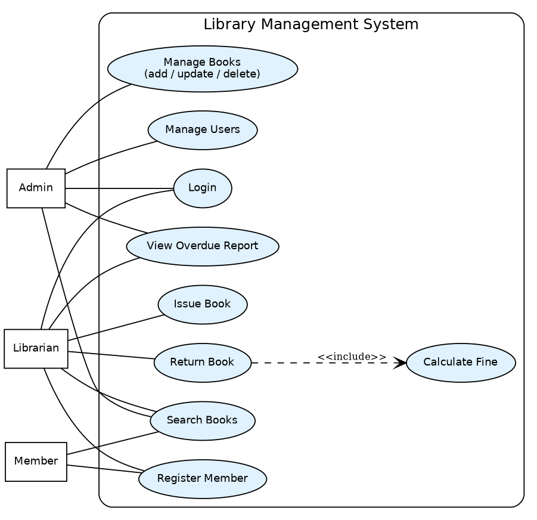
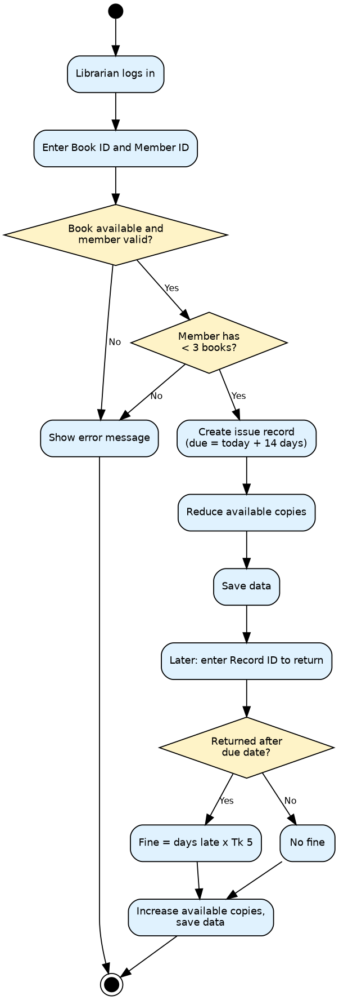

# Library Management System (Java Swing)

Final Capstone Project - Part I: Proposal and Prototype.

A desktop application for a small library: login (Admin / Librarian), book management and search,
member registration, issue and return with a 14-day loan period, automatic fine (Tk 5/day) and an overdue report.

## Run in IntelliJ IDEA
1. Open the folder `LibraryManagementSystem` (File > Open).
2. Mark `src` as **Sources Root** (right-click `src` > Mark Directory as > Sources Root). JDK 17 or newer.
3. Run `library.Main`.
4. Demo logins: `admin / admin123` (can delete books) and `librarian / lib123`.

Data is saved as CSV files in the `data/` folder (created automatically on first run).

## Run from the command line
```
javac -d out src/library/*.java
java -cp out library.Main
```

## Project structure
| Path | Content |
|---|---|
| `src/library` | Java source: User, Book, Member, IssueRecord, Fine, LibraryService, LoginFrame, MainFrame, Main |
| `report/main.tex`, `report/main.pdf` | LaTeX proposal (process model, schedule, Gantt chart, UML, tests) |
| `docs/diagrams` | DFD (level 0 and 1), use case, activity, ERD, class and object diagrams (PDF/PNG) |

## UML Diagrams

### 1. Data Flow Diagram (Level 0)


### 2. Data Flow Diagram (Level 1)


### 3. Use Case Diagram


### 4. Activity Diagram


### 5. Entity Relationship Diagram (ERD)


### 6. Class Diagram


### 7. Object Diagram

